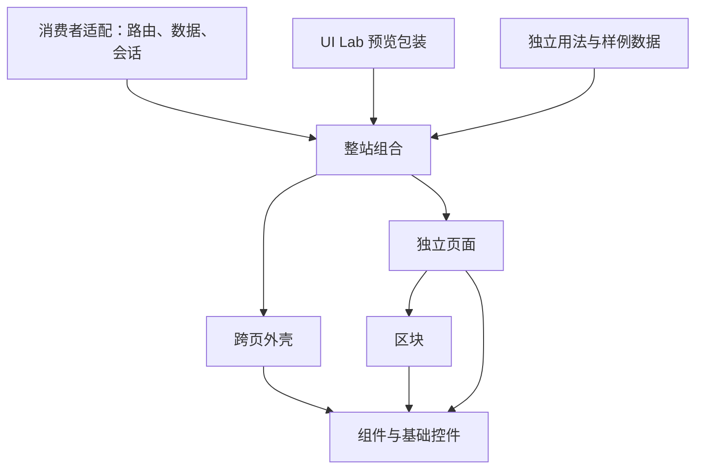

# 整站源码、登记与消费适配：架构候选

日期：2026-10-07。状态：职责分层与扁平入口已确认；具体 API 待实施收敛，没有创建下列产品源码。

用户确认前端资产方向后，具体页面、接口与复用缺口已整理为[后台前端规格草案](2026-10-07-saas-frontend-spec.md)。本文件保留目录对比和宏观边界；已决定内容仍以地图 resolution 为准。

已决定的范围以 [整站前端资产、主题与首个 SaaS 后台模板规格](https://github.com/xiaowen-0725/ui-lab/issues/24) 的已关闭子票及后续用户调整为准；本文件不另存那些票的完整决定。目录详细决定见[目录与登记 resolution](https://github.com/xiaowen-0725/ui-lab/issues/29#issuecomment-6035259967)。已有前提：[外壳与路由](https://github.com/xiaowen-0725/ui-lab/issues/30#issuecomment-6034315845)、[列表与保存](https://github.com/xiaowen-0725/ui-lab/issues/34#issuecomment-6034570486)、[资产复用补齐](https://github.com/xiaowen-0725/ui-lab/issues/35#issuecomment-6035093678)、[主题选择与切换](https://github.com/xiaowen-0725/ui-lab/issues/39#issuecomment-6034742450)。

## 能直接沿用的当前边界

- [ADR 0002](../../docs/adr/0002-catalog-roles-and-install-identities.md) 已定义 `component/block/page/shell/site`，上层引用真实下层实现。
- [registry](../../lib/registry.ts) 目前从 componentSlug 推导 pages/site-shells 的扁平入口路径，从 slug 推导独立用法路径。
- [整站登记](../../lib/sites.ts) 的唯一条目及若干字段字面量类型写死了工作台；新增第二个整站必须放开这一约束。
- [分发实现](../../lib/registry-server.ts) 按 import 闭包收集文件并映射安装 target；文件在哪个目录不等于它承担什么职责。
- [Application Kit](../../APPLICATION_KIT.md) 要求路由、业务请求、鉴权、站点 provider 留在适配层；Theme Kit 不等于完整应用或路由框架。

## 已确认方向：职责目录保持稳定，新增条目采用独立语义名称

第一轮新增资产继续放在当前的职责目录，先不批量迁移历史源码。以下名字只是用于说明职责的候选，最终中文/英文名称、slug、导出及真实 source family 在资产票中确定。

```text
components/
  motion/、agents/、sections/          复用已有组件与区块，保留历史路径
  motion/
    page-pagination.tsx              页码控件的新职责入口
    metric-trend-chart.tsx            使用成熟绘图能力的趋势入口
  pages/
    workspace-overview-page.tsx       工作区总览
    project-list-page.tsx             项目列表
    project-detail-page.tsx           项目详情与编辑
    workspace-members-page.tsx        工作区成员
    workspace-billing-page.tsx        工作区账单
    workbench-settings-page.tsx       既有设置页，补后台用法与保存事务
    account-sign-in-page.tsx          登录入口
    account-sign-up-page.tsx          注册入口
    password-recovery-page.tsx        找回密码入口
  site-shells/
    dashboard-shell.tsx               后台跨页框架
    project-workspace-site.tsx        引用壳与真实页面的整站组合
  examples/
    pages/                           各页面独立用法
    sites/                           壳/整站独立用法与本地 controller
  previews/
    pages/、sites/                    UI Lab 站点包装及演示控制

lib/
  pages.ts                           页面事实与身份
  sites.ts                           整站事实、页面/壳关联
  registry.ts                        可安装条目投影
  recipes.ts                         组合约束
  theme-kits/                        视觉 token

消费者运行示例（位置由交付票决定）
  项目入口、路由、主题应用
  页面适配与样例数据/本地动作
  真实请求与会话接入的说明
```

这种候选与现有扁平源码定位兼容。目录中不会因为页面叫“项目详情”就建立真实项目 API，也不会因为存在登录界面就自动加入会话服务。

后续同职责可以由多个整站共享。营销整站与个人整站各自增加合适页面和外壳，登记到相同领域规则；用途发现不应要求复制一套通用组件或给每种网站建立新的顶级产品对象。

### 首版具体登记推导

以下是已确认目录契约在草案中的推导，以目录票 resolution 为准，不表示已修改登记或源码。

| 事实与身份 | 推荐首版处理 | 当前代码依据与限制 |
| --- | --- | --- |
| 页面入口 | 延续 componentSlug → components/pages/*.tsx；既有设置身份保留 | PageDefinition 已使用通用字符串，无需因第二个整站批量改结构 |
| 壳入口 | DashboardShell 独立登记 assetRole=shell，显式 file/usageFile；整站引用它 | shell 不伪装成第二个 SiteDefinition，浏览入口与历史 category 的具体投影由发现票衔接 |
| 整站入口 | 延续 componentSlug → components/site-shells/*.tsx；SITES 声明真实页面/壳引用 | 第二项只放开实际阻塞的 componentSlug、shellComponent、pagePath 字面量约束；首版仍推荐 graphite，不为未来未知系统虚构值 |
| owned family | 入口及确属本条目的 extraFiles；若页面真有多文件 family，在领域登记加可选 extraFiles 再由 registry 投影 | Catalog sourceFiles 目前由 target.file + extraFiles 产生；共享下层引用不被整站重复声明为拥有 |
| 安装闭包 | actual import 图生成 installationFiles；独立页只带必需控件与 helper | 趋势图依赖只进入使用它的安装图。整站 metadata 的 components 列表不替代 import 图；sourceFiles 与 installationFiles 不合并成另一份手写清单 |
| 用法 | 延续页面/整站 slug 推导 usageFile，壳显式登记；样本与 controller 留 examples，preview 引用真实用法/资产 | 可共享样本时才共置示例 helper，不在分发入口反向 import examples/previews |
| helper | 单处使用共置；跨资产已有公共 helper 继续沿用，有真实复用时抽出 | 不先建立 forms/store/services 的通用层，路径数量不是独立职责的依据 |
| 用途发现 | 沿同一 SITES 真源扩展确实需要的用途事实，经 Catalog 投影 | 首版具体字段和筛选 UI 由发现票决定，不另建 templates 清单或新顶级空间 |

目录选择比较：职责扁平入口保留当前默认定位和用法约定；系列子目录需要显式入口 override 与相应兼容检查。首版推荐前者，在新资产出现真实共置需求时再增量扩展定位，不预先迁移旧文件。源码命名候选见复用票，当前没有创建这些 TS/TSX 文件。

## 对比候选：系列子目录

另一种方案是新增 `components/pages/project-workspace/` 等系列目录，同时在登记中显式声明 `sourceFile/sourceFiles/usageFile`，替换仅从 slug 推导路径的假设。它有利于大型系列共置，但首次实现会扩大登记契约、分发、预览、独立用法、快照及兼容检查范围。

若后续确有多系列、同名内部模块或大量共置 helper 的需求，这种方案值得再讨论；首版已选择职责扁平入口，当前不迁移公开路径，也不维护两份事实。本段保留历史备选及后续演进边界。

## 依赖方向与框架边界



没有从可分发源码反向指向预览、示例数据或消费者框架的依赖。Catalog/registry 读取领域登记及真实源码闭包，不成为页面运行时的业务依赖。

外壳以内容 slots、导航状态与动作适配为职责；整站组合引用独立页面。外壳/路由边界已确认，详细决定见[导航 resolution](https://github.com/xiaowen-0725/ui-lab/issues/30#issuecomment-6034315845)；查询与草稿职责亦已在数据票确定，具体 prop 名称在实现前收敛。消费工程仍可直接组合独立 shell 与 page，而不必安装整个 site。

## 用户澄清后的前端交付候选

用户强调聚焦组件及前端相关资产。此前工程生成、鉴权/数据库/订阅服务组合是代理过度扩展；该候选已撤回，不作为当前架构实施依据。完整工程研究保留为外部事实资料，其服务与生成器建议不构成本轮需求。

推荐用同一套真实源码连接两种消费粒度：按需安装组件/区块/页面，或安装引用这些资产的整站前端组合。示例工程只承载运行入口、导航适配、主题 provider、本地数据与本地动作，用来体验和验证资产。它不拥有另一份页面实现，也不要求使用者接入某个身份、数据库或支付供应商。

| 层级 | 示例职责 | 消费方式 |
| --- | --- | --- |
| 组件 | 按钮、表格、筛选器、对话框等一个界面职责 | 在已有项目按需安装 |
| 区块 | 统计区、列表工具栏、成员管理区、账单摘要 | 引用组件并接收数据/动作 |
| 页面 | 总览、项目列表/详情、成员、账单、设置及账号入口 | 完整界面与受控交互契约 |
| 外壳 | 侧栏、顶栏、移动导航及内容区域 | 复用导航结构，通过适配接入路由 |
| 整站 | 外壳与独立页面的连贯组合 | 同一 source family 的整站预览和安装 |

目录沿用前文 components 与领域登记规则。暂不建立 starters/服务模块/工程生成器目录；examples/previews 和独立消费者夹具分别负责用法、可视展示及消费验证。首版已选择职责扁平入口，不因新增系列批量迁移公开源码。

## 用前端整站案例检验资产

1. SaaS 后台：从总览进入项目列表，筛选后打开详情，修改、校验、保存失败/重试，再到成员、账单和设置。所有示例动作在本地 controller 中实现，页面接收 props/回调；登录和账单界面分别表达提交/选择方案等动作，不实现真实会话或支付。
2. 营销整站：公共导航、产品介绍、价格区、FAQ 与行动入口共用公共外壳。后续组合共享基础组件和主题，内容结构由合适页面承担，不套用后台导航。
3. 个人网站：主页、作品/文章、联系入口共用公共外壳，按所需资产组合。此为架构检验场景，不是首版实现承诺。
4. 换主题：项目详情仍有未保存草稿时切换品牌/明暗，数据、页面与焦点行为保持连续。主题票已确认运行时选择、本机偏好与实际模式范围；具体页面组合仍需实现验收。

推荐先让一个完整后台案例使用共享资产，借此暴露真正需要的表格、表单、导航、图表与状态能力，再补齐资产。整站有完整演示不意味着每个组件都要理解项目、成员或订阅等业务。

## 主题与便捷使用的候选边界

品牌主题与明暗模式建议分别表达，组件使用语义 token，业务查询/草稿不由主题 provider 拥有。表面、边框、状态色、图表、字体与密度需要明确覆盖范围；具体兼容主题×模式组合以消费者验证为依据，不能从全局 CSS 替换推断所有历史资产都兼容。

未来的便捷使用入口可围绕“选择整站与主题 → 安装真实源码闭包 → 接入导航/数据回调”讨论。优先沿用 registry 和现有资产身份，安装/复制体验在发现与交付票细化；不预先新增生成命令或通用项目配置协议。

## 已明确交互与下一前沿

列表、显式保存/会话草稿、当前页选择、导航深链、主题状态保留及目录边界已在相应票记录。下一前沿是视觉与发现/安装，分别验证真实页面组合及消费入口。具体业务规则由消费者提供，避免提前加入通用 store 或后台数据框架。

## 当前交付状态

只有源文件读取、候选架构说明与 issue 规划。没有新增组件、页面、外壳或 Catalog 项，没有安装/构建/浏览器验证，也没有提交、推送或发布。本文中的名字、目录和 Mermaid 只用于解释待决方案。
